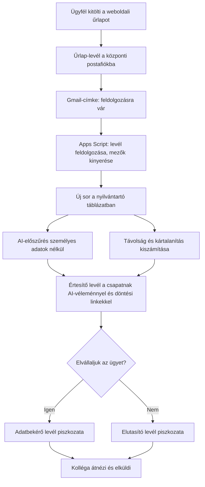

# Ügyintézési automatizáció AI-előszűréssel

**Megrendelő:** légijárat-késési és -törlési kártérítéssel foglalkozó jogi iroda (9 fős csapat, 4 ügyvéd)
**Időszak:** 2026 ősz – folyamatban
**Szerepem:** a teljes rendszer megtervezése, fejlesztése, tesztelése és a csapat betanítása

## A probléma

Az iroda weboldaláról érkező kártérítési igénylések e-mailben futottak be, és kézzel kellett őket táblázatba másolni, kiosztani az ügyvédeknek, majd egyenként megírni az ügyfeleknek szóló adatbekérő vagy elutasító levelet. Heti kb. 20 új ügynél ez sok ismétlődő, hibalehetőséggel teli munka volt.

## A megoldás

A rendszer leveleket **soha nem küld el magától**: minden ügyfélnek szóló levél piszkozatként készül el, és ember hagyja jóvá.

### Fő funkciók

- **Automatikus feldolgozás:** a címkézett űrlap-leveleket a script beolvassa, a mezőket (repülőtér, járatszám, légitársaság, esemény, dátum, leírás) kinyeri, és rendezett sorként felviszi a táblázatba.
- **Döntési folyamat webalkalmazással:** a csapat egy kattintással jelezhet Igen/Nem döntést a levélben kapott linkekkel. Készült egy többségi szavazásos változat is (bármely 2 egyező szavazat a 4 ügyvédből), amely kapcsolóval be- és kikapcsolható; a csapat jelenleg a kézi döntést használja.
- **AI-előszűrés (OpenAI API):** minden új ügyhöz rövid, szabályalapú előzetes véleményt kér, amelyet a táblázatban színkód jelöl (zöld: vihető, piros: nem vihető, sárga: jogászi vizsgálat kell, szürke: nincs értékelhető válasz).
- **Kártalanítás-számítás:** a két repülőtér légvonalbeli távolságából (Google Térkép-alapú geokódolással) kiszámolja az EU 261/2004 rendelet szerinti összeget utasonként és összesen.
- **Levélpiszkozatok:** döntés után automatikusan elkészül az adatbekérő vagy az elutasító levél piszkozata.
- **Csapatkommunikáció:** javaslatomra a lezáratlan ügyek egyeztetése Slack-csatornára kerül, ügyenként egy szálban, mert az e-mail túlterhelt volt.

## Az AI-előszűrés részletei

Részletesen: [ai-elszures-szabalyok.md](ai-elszures-szabalyok.md)

- Az AI csak a légitársaságot, járatszámot, útvonalat, eseménytípust, dátumot és az ügyfél leírását kapja meg. **Nevet, e-mail címet, lakcímet nem**, a leírásból is szűrjük a személyes adatokat.
- A szabályok egyetlen, a jogászok által szerkeszthető szabálylistában vannak (`AI_RULES`), így új eset kezeléséhez nem kell kódot módosítani.
- A válasz kötött formában zárul (`JAVASLAT: VIHETŐ / NEM VIHETŐ / BIZONYTALAN - TOVÁBBI INFÓ KELL`), ez alapján színeződik a cella.
- Költség: a mért adatok alapján kb. 0,004 USD értékelésenként, heti 20 ügynél havi kb. 0,35–0,50 USD.

## Tesztelés

10 esetes tesztforgatókönyvet írtam várt eredményekkel ([tesztforgatokonyv.md](tesztforgatokonyv.md)). Az első körben rögzített 7 esetből 6 egyezett a várttal; az eltérő esetből szabálypontosítás lett, amelyet a jogászokkal egyeztettem.

## Hibakeresés: amit menet közben megoldottam

| Probléma | Ok | Megoldás |
|----------|----|----------|
| A levelekben küldött döntési linkek hibás címre mutattak | `ScriptApp.getService().getUrl()` táblázatmenüből indítva megbízhatatlan | A telepítési URL konstansként rögzítve |
| A döntési link Drive-hibaoldalt adott | Webalkalmazás-kontextusban nincs „aktív táblázat”, a `getActiveSpreadsheet()` csendben hibázik | Mindenhol `openById()` használata |
| Kódmódosítás után a régi verzió futott | Mentés nem frissíti az élő webalkalmazást; új telepítés új URL-t ad, ami a kiküldött linkeket eltöri | Mindig ugyanazon telepítés új verziója, dokumentált lépésekkel |
| Egyes mezők üresen jöttek át | Az éles űrlap-levelek más csillagozást használtak, mint a tesztlevelek | Rugalmasabb formázás-eltávolítás és háromszintű mezőkeresési stratégia |
| Időkorlát túllépése tömeges importnál | Az AI-hívások futásideje | Futásonként legfeljebb 5 ügy feldolgozása |

## Technológiák

Google Apps Script · Google Sheets · Gmail (címkék, piszkozatok, küldési alias) · Apps Script webalkalmazás · OpenAI API (gpt-4o) · Google Maps geokódolás · Slack · cPanel e-mail

## Képernyőképek

Lásd: [kepek/](kepek/) (anonimizált tesztadatokkal)
