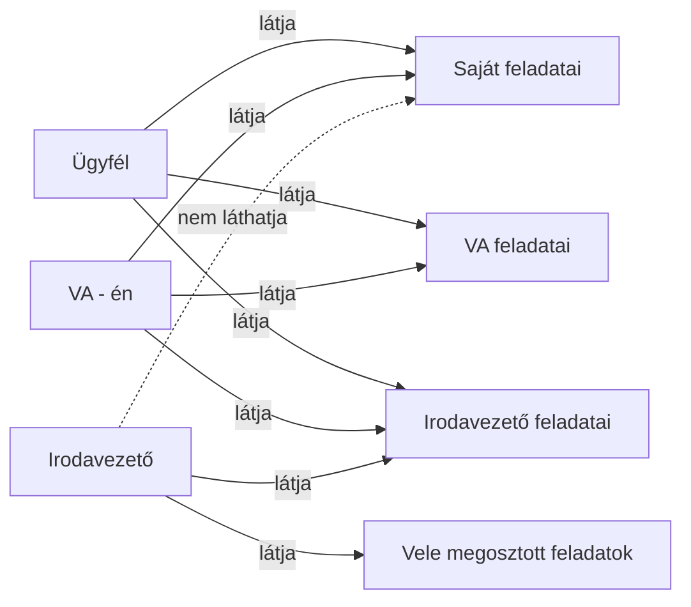
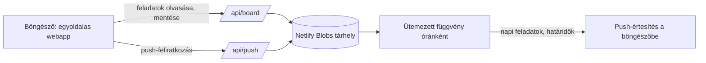

# Közös feladatkezelő webapp – regisztráció nélkül

**Megrendelő:** cégvezető ügyfél és irodavezetője (a továbbiakban: *Ügyfél* és *Irodavezető*)
**Időszak:** 2026 ősz – első fázis fejlesztés alatt
**Szerepem:** igényfelmérés, jogosultsági modell tervezése, fejlesztés, telepítés, tesztelés

## A probléma

Hárman (az Ügyfél, az Irodavezető és én virtuális asszisztensként) közös feladatlistán szerettünk volna dolgozni. A Trello kézenfekvő lett volna, de az Ügyfél nem akart újabb szolgáltatásba regisztrálni. Emellett olyan láthatósági szabályokra volt szükség, amelyeket egy általános eszköz nem tud egyszerűen kezelni: vannak témák, amelyekről az Irodavezető nem tudhat.

## Követelmények

- **Regisztráció nélküli** használat, de hozzáférés-védelemmel
- Állapotok: folyamatban / lezárva, és mindig látszik, kinél van épp a feladat
- Kipipálható feladatok, amelyek archívumba kerülnek, rögzítve, ki zárta le
- Értesítés napi feladatokról és határidőkről, azonnali értesítés átadáskor
- Mindenki csak a saját nevén lévő feladatokat kezeli, a gazdátlanokat bárki átveheti
- „Kérés a felelőstől” gomb
- Feladatonkénti előzmények (ki, mikor, mit módosított)
- Kuka, mentés és exportálás
- Tervezett: egygombos „feladattá alakítás” Outlookból, és használat Teamsből (a bővítményeket a rendszergazdának kell jóváhagynia)

## Jogosultsági modell

A legérzékenyebb rész: az Irodavezető semmilyen körülmények között nem láthatja az Ügyfél magánjellegű ügyeit.

| Szerepkör | Látja | Kezelheti |
|-----------|-------|-----------|
| Ügyfél | Mindenki feladatát | Saját és gazdátlan feladatok |
| Virtuális asszisztens | Mindenki feladatát | Saját és gazdátlan feladatok |
| Irodavezető | Csak a saját és a vele megosztott feladatokat | Saját és gazdátlan (számára látható) feladatok |

## Első fázis

1. Hozzáférés-védelem
2. Kuka, mentés és export
3. Feladatonkénti előzmények
4. Azonnali értesítés átadáskor
5. „Kérés a felelőstől” gomb

## Felépítés

- **Frontend:** egyetlen HTML-oldalas webapp, telepítés és build-lépés nélkül
- **Backend:** Netlify Functions (Node.js) – egy végpont a feladattábla adataihoz, egy a push-értesítések feliratkozásához
- **Ütemezett feladat:** óránként futó Netlify-függvény, amely a napi feladatokról és a közelgő határidőkről értesít
- **Értesítések:** böngészős push-értesítés, regisztráció nélkül
- **Telepítés:** Netlify; a megrendelőnek egyelőre nincs saját domainje, ezért a Netlify-cím marad

A projekt fejlesztés alatt áll; Claude-dal együtt fejlesztem, a követelményeket és a jogosultsági modellt én határozom meg, a tesztelést én végzem.

## Képernyőképek

Lásd: [kepek/](kepek/) (mintaadatokkal, valós feladatok nélkül)
